<div align="center">

# 🏥 AegisHealth AI
### Intelligent Healthcare Decision Support Platform

[](https://fastapi.tiangolo.com)
[](https://react.dev/)
[](https://www.typescriptlang.org/)
[](https://threejs.org/)
[](https://tailwindcss.com/)
[](https://www.python.org/)
[](LICENSE)
[](https://sdgs.un.org/goals/goal3)
[](https://www.niet.co.in)

<p align="center">
  <strong>An Explainable Clinical Triage, Heuristic Graph Routing, and Predictive Resource Management System</strong>
  <br />
  <em>Academic Capstone Project • B.Tech CSE (Artificial Intelligence) • Under the Guidance of Dr. Mohd. Nazim</em>
</p>

[Explore Live Demo](#-local-setup-instructions) • [System Architecture](#-system-architecture) • [API Documentation](#-api-documentation) • [Algorithm Benchmarks](#-aiml-integration)

</div>

---

## 📑 Table of Contents

- [1. Project Overview](#1-project-overview)
- [2. Problem Statement](#2-problem-statement)
- [3. Our Solution](#3-our-solution)
- [4. Key Features](#4-key-features)
- [5. Application Screenshot Gallery](#5-application-screenshot-gallery)
- [6. Technology Stack](#6-technology-stack)
- [7. System Architecture](#7-system-architecture)
- [8. Application Clinical Workflow](#8-application-clinical-workflow)
- [9. Project Directory Structure](#9-project-directory-structure)
- [10. Installation Requirements](#10-installation-requirements)
- [11. Local Setup Instructions](#11-local-setup-instructions)
- [12. Environment Variables Configuration](#12-environment-variables-configuration)
- [13. Frontend Execution](#13-frontend-execution)
- [14. Backend Execution](#14-backend-execution)
- [15. Database Configuration & Auto-Seeding](#15-database-configuration--auto-seeding)
- [16. API Documentation](#16-api-documentation)
- [17. AI & Algorithmic Decision Core](#17-ai--algorithmic-decision-core)
- [18. Security, Privacy & Clinical Safeguards](#18-security-privacy--clinical-safeguards)
- [19. Future Enhancements](#19-future-enhancements)
- [20. Limitations](#20-limitations)
- [21. Contributors & Academic Context](#21-contributors--academic-context)
- [22. License](#22-license)

---

## 1. Project Overview

**AegisHealth AI** is a production-grade, human-in-the-loop clinical decision support platform engineered to assist emergency triage nurses, attending physicians, and hospital operations coordinators.

Developed as a rigorous academic project at **Noida Institute of Engineering & Technology (NIET), Greater Noida**, for the **Artificial Intelligence** curriculum under **Dr. Mohd. Nazim**, the platform bridges theoretical AI search algorithms and uncertainty calculus with mission-critical healthcare workflows mapped directly to **United Nations Sustainable Development Goal 3 (Good Health and Well-Being)**.

The system combines:
1. **Buchanan & Shortliffe Certainty Factor Calculus** to handle incomplete, multi-symptom clinical uncertainty.
2. **Continuous Fuzzy Membership Scoring** for nuanced severity grading rather than rigid binary thresholds.
3. **5-Stage Heuristic Graph Traversal (A\* Search)** evaluating transit delay vs. clinical suitability.
4. **Automated Resource Depletion Forecasting** tracking oxygen burn rates and bed reserve safety rules (<10% capacity warnings).
5. **Interactive Spatial 3D Digital Twin** providing hospital-wide spatial telemetry across critical pavilions.

> [!IMPORTANT]
> **Clinical Decision Support Advisory (Human-in-the-Loop)**: AegisHealth AI is strictly an advisory decision-support platform designed to assist licensed clinicians with prioritization, department routing, and resource planning. Final diagnostic authority and prescription power strictly rest with human medical practitioners.

---

## 2. Problem Statement

Modern emergency healthcare departments operate under acute cognitive strain and rapid resource volatility:

- **Subjective Triage Variance**: Manual intake triage often fluctuates under emergency room surges, causing delays in early intervention for critical time-sensitive conditions (e.g. Acute STEMI, Ischemic Stroke, Hypoxemic ARDS).
- **Inflexible Decision Boundaries**: Real-world patient vitals and symptoms rarely present in textbook discrete buckets; rigid if-else logic fails to evaluate continuous degrees of acuity and conflicting evidence.
- **Suboptimal Inter-Department Routing**: Patients often experience transit and turnaround delays through congested diagnostic pipelines because routing ignores cumulative facility delay costs.
- **Late Shortage Detection**: Critical hospital resources (ICU beds, medical oxygen, ventilators, antithrombotics) are often restocked reactively after exhaustion rather than proactively via continuous burn-rate projection.

---

## 3. Our Solution

AegisHealth AI resolves these challenges through a unified, explainable clinical intelligence framework:

```
[Patient Presentation & Vitals]
              │
              ▼
 ┌──────────────────────────┐
 │ Rule-Based Early Filter  │ ──► Red-Flag Protocol Escapes (STAT Cath Lab / Stroke Alert)
 └──────────────────────────┘
              │
              ▼
 ┌──────────────────────────┐
 │ Uncertainty Reasoning    │ ──► Buchanan & Shortliffe CF Calculus + Fuzzy Urgency Grading
 └──────────────────────────┘
              │
              ▼
 ┌──────────────────────────┐
 │ Heuristic Decision Graph │ ──► A* Search Traversal (f(n) = g(delay) + h(clinical_fit))
 └──────────────────────────┘
              │
              ▼
 ┌──────────────────────────┐
 │ Decision Passport Output │ ──► Human-in-the-Loop Physician Review & Final Sign-Off
 └──────────────────────────┘
```

---

## 4. Key Features

| Category | Capability | Description |
| :--- | :--- | :--- |
| **Clinical Triage** | **Explainable AI Recommendations** | Generates transparent Decision Passports with symptom weights, rule traces, and zero-jargon clinical rationales. |
| **Uncertainty AI** | **Certainty Factor Calculus** | Buchanan & Shortliffe combined belief degrees ($CF \in [-1.0, +1.0]$) that degrade gracefully under missing data. |
| **Fuzzy Logic** | **Continuous Acuity Membership** | Trapezoidal and triangular membership functions grading Mild, Moderate, Severe, and Critical presentations. |
| **Graph Traversal** | **A\* vs. Multi-Algorithm Search** | Traverses a 5-stage clinical graph comparing A*, Greedy Best-First, BFS, and DFS with latency < 200ms. |
| **Interactive 3D** | **Spatial Decision Graph Canvas** | WebGL/Three.js interactive 3D spatial graph with traveling energy packets, orbital controls, and 2D fallback. |
| **Hospital Twin** | **3D Campus Digital Twin** | Spatial visualization of Trauma, Cardio, ICU, Neuro, Pulmonology, and Pediatric pavilions with alert pulsing. |
| **Resource Safety** | **Predictive Shortage Rules** | Proactive 48-hour burn trajectories on oxygen and emergency warning banners when bed capacity drops below 10%. |
| **Stress Testing** | **Mass Casualty (MCI) Sandbox** | Simulates sudden patient influxes to evaluate hospital elasticity and automatic restock triggers. |
| **Workforce** | **Clinical Load Balancing** | Real-time shift roster with attendance tracking and workload warnings when an attending physician exceeds 5 acute cases. |
| **Compliance** | **Audit Logging & SDG Impact** | Comprehensive tamper-evident clinical audit trails with quantifiable metrics aligned to UN SDG 3. |

---

## 5. Application Screenshot Gallery

*All screenshots captured directly from the running production-grade application.*

### 5.1 Landing Page & Clinical Overview
The public landing page featuring real-time telemetry, 3D animated DNA helix background, academic course badge, and quick platform launching.
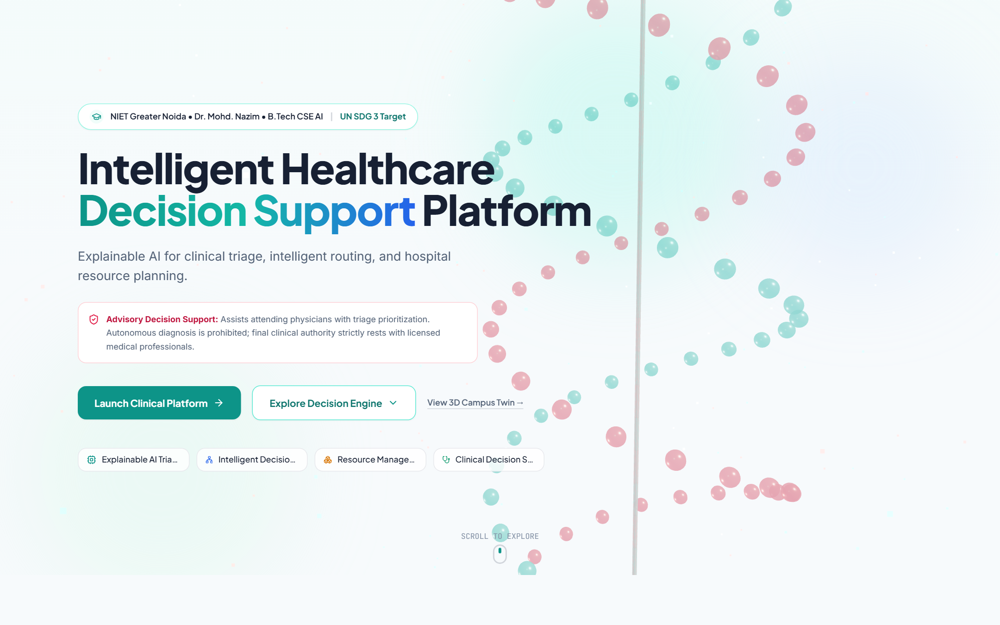

---

### 5.2 Clinical Role Authentication
Secure authentication portal supporting Doctor, Staff/Nurse, and Admin profiles with 1-click academic demo credentials.
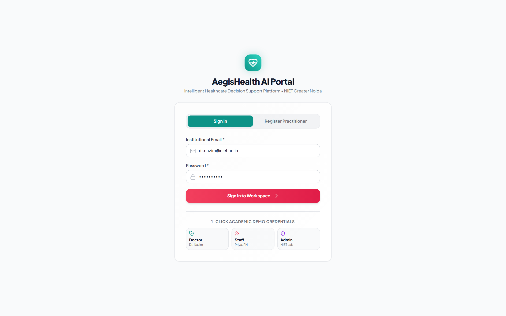

---

### 5.3 Real-Time Clinical Operations Dashboard
Central nerve center displaying registered patient trends, on-duty workforce rosters, active resource warnings, and live priority patient queue with mini SVG sparklines.
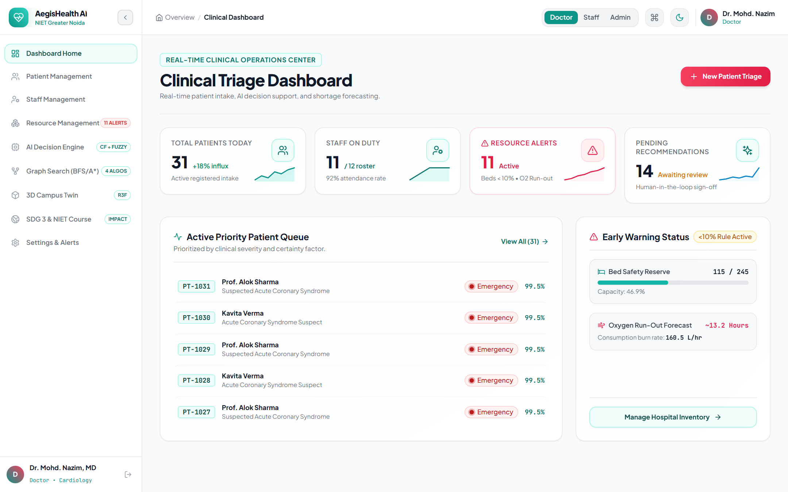

---

### 5.4 Patient Intake & Triage Management
Searchable, filterable patient management registry with ESI urgency stream badges, fuzzy severity indicators, and AI match percentages.
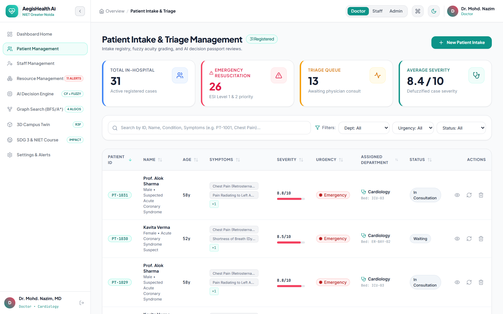

---

### 5.5 Patient Decision Passport & Detail Slide-Over
Detailed patient drawer presenting vitals, primary department recommendations, certainty factors, activated clinical rules, and immutable audit logs.
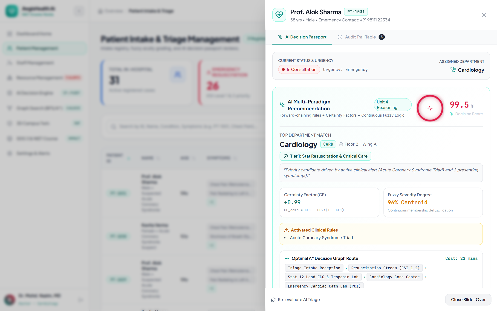

---

### 5.6 AI Decision Engine & Clinical Reasoning Studio
Interactive triage consultation studio featuring a 5-stage decision pipeline (Intake $\rightarrow$ Rules $\rightarrow$ Certainty Factors $\rightarrow$ A\* Routing $\rightarrow$ Terminal Intervention).
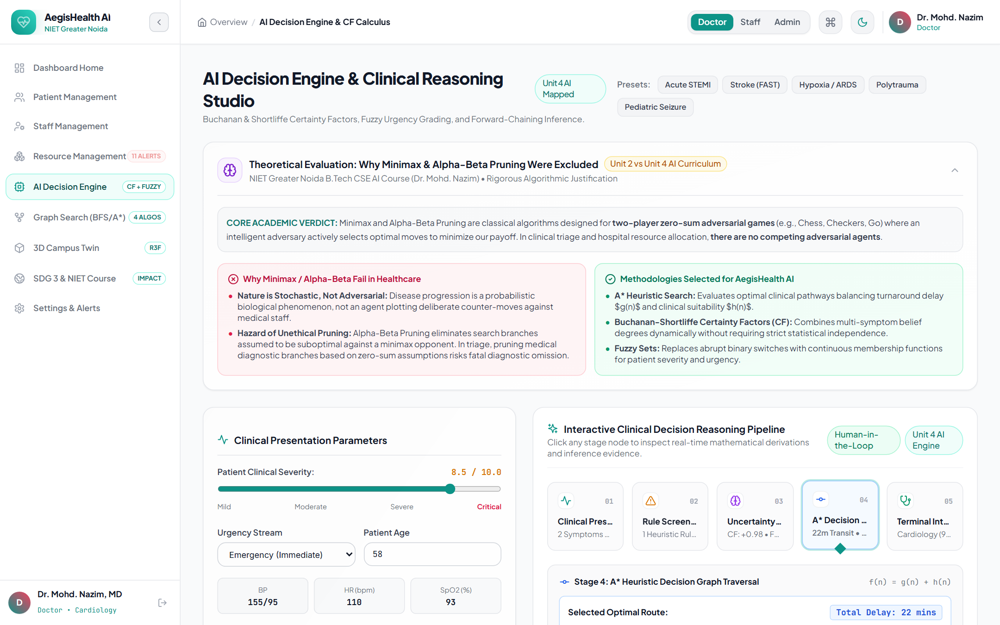

---

### 5.7 Interactive 3D Healthcare Decision Graph Search
Three.js spatial graph visualization showing 5-stage node progression, step scrubbing, variable playback speeds (0.5x to 4x), and animated traveling energy conduits.
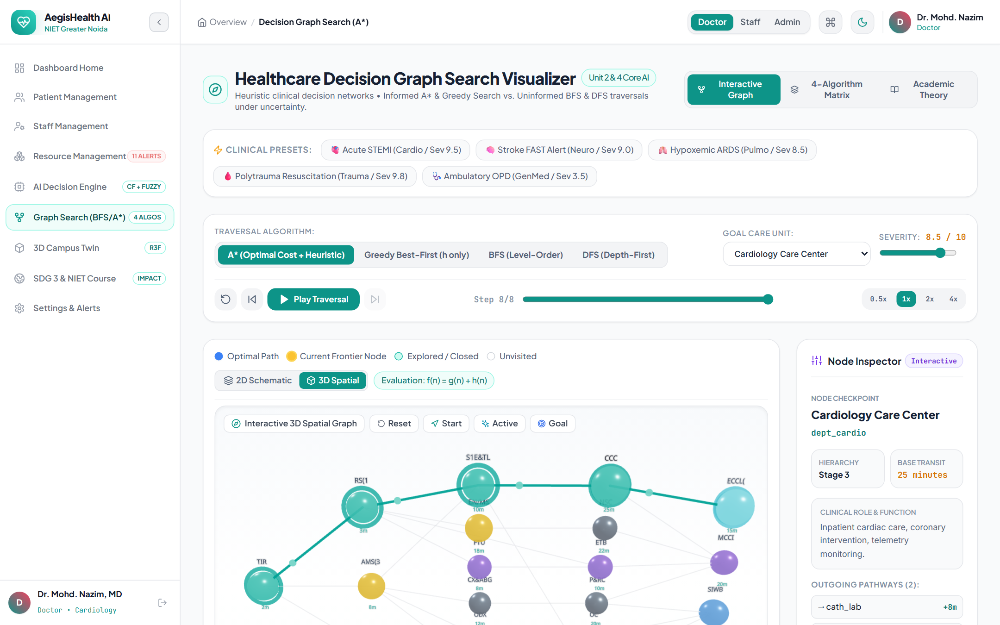

---

### 5.8 4-Algorithm Comparative Benchmark Matrix
Side-by-side empirical comparison between A\* Search, Greedy Best-First Search, Breadth-First Search (BFS), and Depth-First Search (DFS) with execution latency and nodes expanded.
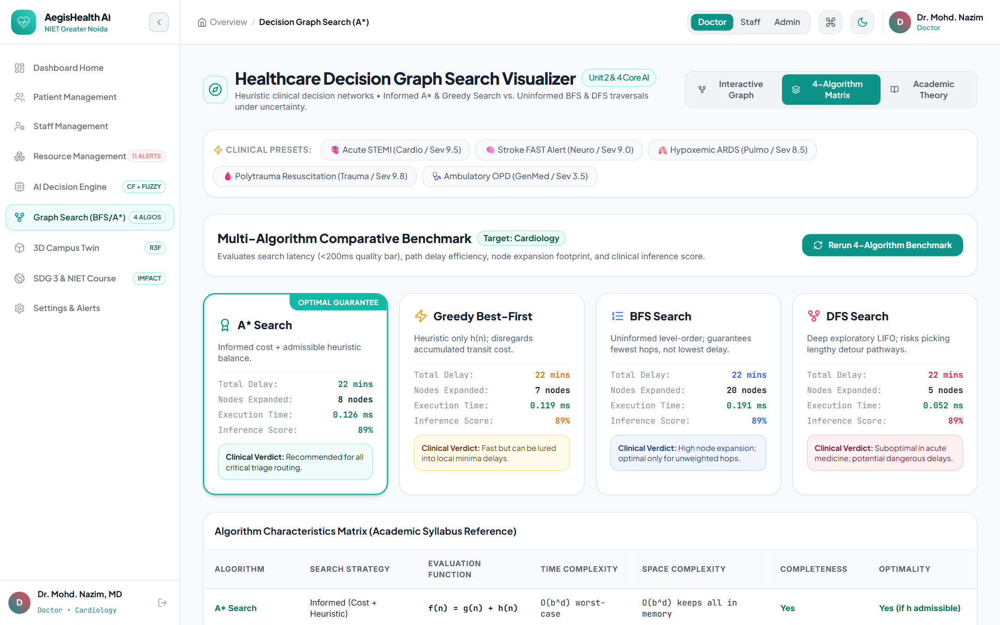

---

### 5.9 Resource Inventory & Predictive Shortage Forecasting
Hospital inventory tracker with real-time 48-hour burn trajectories, editable safety thresholds, and Mass Casualty Incident (MCI) stress-testing sandbox.
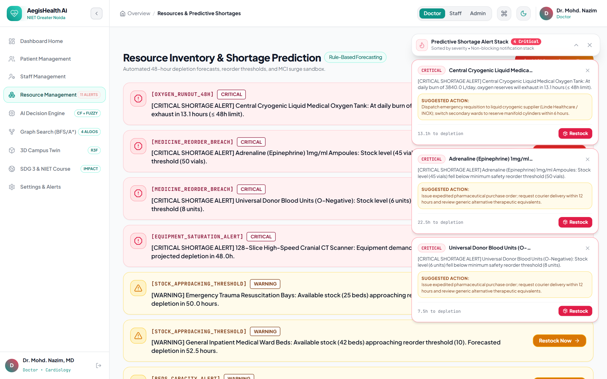

---

### 5.10 Hospital Campus 3D Digital Twin
Spatial Three.js digital twin with pulsating department pavilions (Trauma, Cardio, ICU, Neuro, Pulmonology, Pediatrics) reflecting real-time alert states.
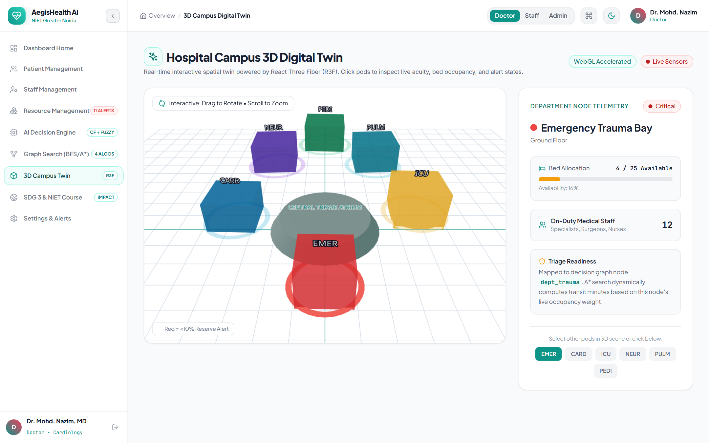

---

### 5.11 UN SDG 3 Impact & Course Mapping
Academic course alignment dashboard presenting door-to-treatment turnaround reduction, shortage pre-emption records, and immutable system audit logs.
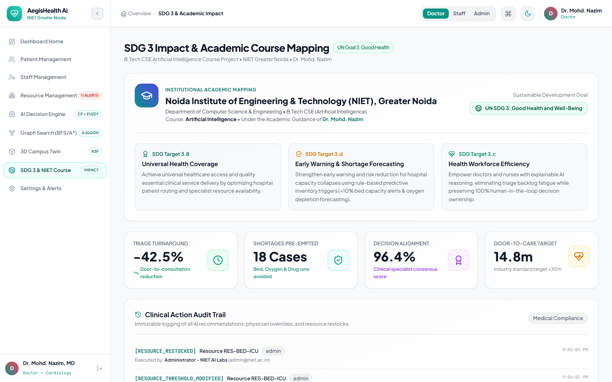

---

## 6. Technology Stack

### Frontend Architecture
- **Core Framework**: [React 18.2](https://react.dev/) with [TypeScript 5.4](https://www.typescriptlang.org/)
- **Build System & Dev Server**: [Vite 5.4](https://vitejs.dev/) with fast HMR
- **Styling & Design System**: [Tailwind CSS 3.4](https://tailwindcss.com/) with custom clinical tokens
- **Motion & Micro-Interactions**: [Framer Motion 11](https://www.framer.com/motion/) with standardized timing curves
- **3D Graphics & Spatial Twin**: [Three.js r162](https://threejs.org/) with [@react-three/fiber](https://docs.pmnd.rs/react-three-fiber) and [@react-three/drei](https://github.com/pmndrs/drei)
- **Icons**: [Lucide React](https://lucide.dev/)
- **Client Routing**: [React Router DOM v7](https://reactrouter.com/)

### Backend Architecture
- **Application Server**: [FastAPI 0.110](https://fastapi.tiangolo.com/) (Asynchronous Python ASGI)
- **ASGI Web Server**: [Uvicorn 0.28](https://www.uvicorn.org/)
- **Data Validation & Typing**: [Pydantic v2](https://docs.pydantic.dev/)
- **Database ORM**: [SQLAlchemy 2.0](https://www.sqlalchemy.org/)
- **Security & Cryptography**: Python `secrets`, `hashlib` (PBKDF2-HMAC-SHA256), `PyJWT 2.8`
- **Real-Time Telemetry**: WebSockets for multi-tab roster synchronization
- **Testing Framework**: [pytest 8.0](https://docs.pytest.org/) with `httpx` TestClient

### Database & Persistence
- **Default Database**: SQLite 3 with WAL mode enabled (`sqlite:///./aegis_health.db`)
- **Production Option**: PostgreSQL 15+ via `psycopg2-binary`
- **Schema Management**: SQLAlchemy declarative base models with automated seeding

---

## 7. System Architecture

```
                                  [ CLINICAL CLIENTS ]
          Emergency Nurses • Attending Physicians • Operations Coordinators
                                           │
                                           ▼ (HTTPS / WebSocket)
┌───────────────────────────────────────────────────────────────────────────────────┐
│                           REACT 18 + VITE FRONTEND                                │
│  ┌───────────────────────┐ ┌───────────────────────┐ ┌─────────────────────────┐  │
│  │ Clinical Dashboards   │ │ 3D Spatial Visualizer │ │ Decision Passports      │  │
│  │ Tailwind CSS • Motion │ │ Three.js • R3F • Drei │ │ Explainable UI & Vitals │  │
│  └───────────────────────┘ └───────────────────────┘ └─────────────────────────┘  │
└──────────────────────────────────────────┬────────────────────────────────────────┘
                                           │ (JSON REST API v1)
                                           ▼
┌───────────────────────────────────────────────────────────────────────────────────┐
│                            FASTAPI BACKEND SERVICE                                │
│  ┌─────────────────────────────────────────────────────────────────────────────┐  │
│  │ Request Gateway: CORS Middleware • Request ID Generator • Structured Logger │  │
│  ├─────────────────────────────────────────────────────────────────────────────┤  │
│  │ Security & RBAC: JWT Bearer Guard • PBKDF2 Password Verifier • Role Checker │  │
│  ├─────────────────────────────────────────────────────────────────────────────┤  │
│  │ Routers: /auth • /patients • /staff • /resources • /ai • /analytics        │  │
│  └───────────────────────────────────────┬─────────────────────────────────────┘  │
└──────────────────────────────────────────┼────────────────────────────────────────┘
                                           │
                    ┌──────────────────────┴──────────────────────┐
                    ▼                                             ▼
┌───────────────────────────────────────┐   ┌───────────────────────────────────────┐
│       AI DECISION REASONING CORE      │   │          PERSISTENCE LAYER            │
│  ┌─────────────────────────────────┐  │   │  ┌─────────────────────────────────┐  │
│  │ Certainty Factor Calculus (CF)  │  │   │  │ SQLAlchemy 2.0 ORM Engine       │  │
│  │ Buchanan & Shortliffe Formula   │  │   │  ├─────────────────────────────────┤  │
│  ├─────────────────────────────────┤  │   │  │ Relational Schema:              │  │
│  │ Continuous Fuzzy Acuity Sets    │  │   │  │ Users • Patients • Staff        │  │
│  │ Mild / Moderate / Severe / Crit │  │   │  │ Resources • AuditLogs           │  │
│  ├─────────────────────────────────┤  │   │  ├─────────────────────────────────┤  │
│  │ Heuristic Graph Search Engine   │  │   │  │ Storage Engine:                 │  │
│  │ A* Search • GBFS • BFS • DFS   │  │   │  │ SQLite WAL / PostgreSQL 15+     │  │
│  ├─────────────────────────────────┤  │   │  ├─────────────────────────────────┤  │
│  │ Predictive Resource Shortage    │  │   │  │ Seed Engine:                    │  │
│  │ 48h Burn Trajectory + <10% Rule │  │   │  │ Auto-loads Month 2 Scenarios    │  │
│  └─────────────────────────────────┘  │   │  └─────────────────────────────────┘  │
└───────────────────────────────────────┘   └───────────────────────────────────────┘
```

The system architecture diagram is saved at [`docs/architecture.png`](docs/architecture.png):
<div align="center">
  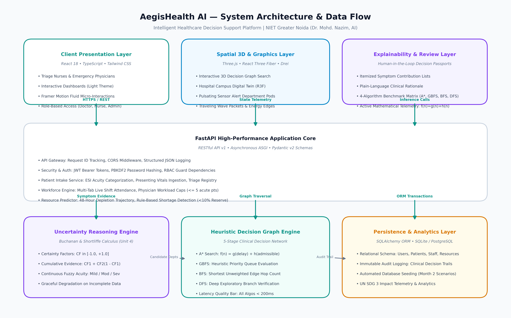
</div>

---

## 8. Application Clinical Workflow

The clinical workflow mirrors standardized emergency triage protocols while injecting explainable AI telemetry:

```
[1. Patient Intake]
     └── Patient presents with demographics, chief complaints, and vitals (BP, HR, SpO2, Temp).
[2. Rule-Based Screening]
     └── Forward-chaining rules immediately scan for high-acuity triads (STEMI chest pain, FAST stroke).
[3. Uncertainty Calculus]
     └── Buchanan & Shortliffe Certainty Factors combine multi-symptom belief degrees.
     └── Continuous fuzzy functions map severity [1.0 to 10.0] into categorized membership sets.
[4. Heuristic Decision Graph Routing]
     └── Traverses 5 hierarchical stages: Intake -> Acuity Stream -> Diagnostics -> Clinical Dept -> Destination.
     └── A* search evaluates f(n) = g(delay) + h(clinical_suitability) guaranteeing optimal turnaround.
[5. Resource Impact Projection]
     └── Real-time rule engine evaluates facility burn rate and checks if bed reserve falls below 10%.
[6. Physician Authorization]
     └── Attending doctor inspects Decision Passport with plain-language explanation and signs off.
```

---

## 9. Project Directory Structure

```text
Intelligent-HealthCare-Decision-Support-Platform/
├── .github/
│   └── workflows/              # CI/CD workflows for lint, test, and build
├── backend/
│   ├── app/
│   │   ├── ai_engine/          # AI Decision Engine modules
│   │   │   ├── cf_calculus.py  # Buchanan & Shortliffe Certainty Factor math
│   │   │   ├── fuzzy.py        # Triangular/trapezoidal fuzzy membership sets
│   │   │   ├── inference.py    # Multi-criteria clinical inference engine
│   │   │   ├── rules.py        # Forward-chaining triage rules
│   │   │   ├── search_graph.py # 5-Stage Graph Search (BFS, DFS, Greedy, A*)
│   │   │   └── shortage_predictor.py # 48h depletion & <10% reserve rules
│   │   ├── core/               # Security, dependencies, token generation
│   │   ├── models/             # SQLAlchemy declarative relational entities
│   │   ├── routers/            # FastAPI endpoints (auth, patients, staff, etc.)
│   │   ├── schemas/            # Pydantic v2 validation contracts
│   │   ├── config.py           # Central settings & environment loader
│   │   ├── database.py         # Database session & engine factory
│   │   ├── main.py             # FastAPI entry point & lifespan manager
│   │   └── seed_data.py        # Month 2 academic benchmark scenario seeder
│   ├── requirements.txt        # Backend dependencies
│   ├── test_e2e_critical_paths.py # Critical user journey end-to-end tests
│   ├── test_phase4.py          # Patient management tests
│   ├── test_phase5.py          # Staff roster & attendance tests
│   ├── test_phase6.py          # Resource shortage prediction tests
│   └── test_phase7.py          # AI decision core & search algorithm tests
├── docs/
│   ├── architecture.png        # High-resolution 300 DPI system architecture diagram
│   └── screenshots/            # 11 genuine live application screenshots
├── frontend/
│   ├── public/                 # Static public assets
│   ├── src/
│   │   ├── components/
│   │   │   ├── 3d/             # Three.js / R3F Hospital Campus Digital Twin
│   │   │   ├── ai/             # Triage Studio, Decision Graph & Benchmark Matrix
│   │   │   ├── auth/           # Login & Registration views with 1-click roles
│   │   │   ├── common/         # GlassCard, Badges, SkeletonLoaders, Modals
│   │   │   ├── dashboard/      # Main Operations Center & mini sparklines
│   │   │   ├── landing/        # Hero, DNA Helix 3D Scene, Features, Timeline
│   │   │   ├── layout/         # DashboardShell with sliding active indicator
│   │   │   ├── patient/        # Patient table, intake modal, detail drawer
│   │   │   ├── resource/       # Resource inventory, Area charts, MCI simulator
│   │   │   ├── sdg/            # UN SDG 3 impact & course mapping
│   │   │   ├── settings/       # Alert threshold & notification preferences
│   │   │   └── staff/          # Staff roster & shift management
│   │   ├── context/            # AuthContext and ThemeContext
│   │   ├── services/           # Typed API service clients (fetch wrapper)
│   │   ├── types/              # Central TypeScript interfaces & enums
│   │   ├── utils/              # Standardized motion tokens & timing curves
│   │   ├── App.tsx             # Route declarations & shell wrapper
│   │   ├── main.tsx            # React root mount
│   │   └── index.css           # Tailwind directives & design tokens
│   ├── package.json            # Frontend dependencies & npm scripts
│   ├── tsconfig.json           # TypeScript compiler configuration
│   └── vite.config.ts          # Vite build pipeline & dev proxy
├── scripts/
│   ├── capture_screenshots.js  # Automated browser screenshot capture utility
│   └── generate_architecture_diagram.py # Matplotlib architecture generator
├── .env.example                # Documented environment variable template
├── .gitignore                  # Git exclusion rules (node_modules, pycache, etc.)
├── CONTRIBUTING.md             # Code contribution & clinical safety guidelines
├── demo.bat                    # One-click Windows launch script
├── demo.sh                     # One-click Linux/macOS launch script
├── docker-compose.yml          # Containerized multi-service deployment
├── LICENSE                     # MIT Open Source License
├── README.md                   # Project documentation
└── requirements.txt            # Root Python dependencies
```

---

## 10. Installation Requirements

Before running AegisHealth AI, ensure your system has:

- **Python**: Version `3.10`, `3.11`, `3.12`, or `3.14`
- **Node.js**: Version `18.x`, `20.x`, or `22.x+` (npm `9.x+`)
- **Git**: Installed and available in your terminal path
- **RAM**: Minimum 4 GB (8 GB recommended for Three.js canvas rendering)
- **Web Browser**: Google Chrome, Microsoft Edge, or Mozilla Firefox with WebGL enabled

---

## 11. Local Setup Instructions

Clone the repository and set up your local development environment:

```bash
# 1. Clone the repository
git clone https://github.com/adil9161/Intelligent-HealthCare-Decision-Support-Platform.git
cd Intelligent-HealthCare-Decision-Support-Platform

# 2. Configure environment file
cp .env.example .env
```

---

## 12. Environment Variables Configuration

The application operates out-of-the-box with local SQLite defaults. You can adjust settings in your `.env` file:

| Variable | Default Value | Description |
| :--- | :--- | :--- |
| `SECRET_KEY` | `niet_cse_ai_healthcare_secret_key_...` | Cryptographic secret for signing JWT access tokens. |
| `ALGORITHM` | `HS256` | JWT signing algorithm. |
| `ACCESS_TOKEN_EXPIRE_MINUTES` | `1440` (24 Hours) | Validity duration for clinician login sessions. |
| `DATABASE_URL` | `sqlite:///./aegis_health.db` | Connection string (SQLite WAL or PostgreSQL). |
| `BACKEND_CORS_ORIGINS` | `["http://localhost:5173", ...]` | Permitted frontend origins. |

---

## 13. Frontend Execution

Install frontend dependencies and launch the Vite development server:

```bash
# Navigate to frontend directory and install dependencies
cd frontend
npm install

# Start Vite development server
npm run dev
```

The frontend will be active at: **`http://localhost:5173`**

To verify a production build:
```bash
npm run build
```

---

## 14. Backend Execution

Install Python requirements and start the FastAPI ASGI service:

```bash
# From the repository root, install dependencies
pip install -r requirements.txt

# Start FastAPI via the included runner script
python run_backend.py
```

Or run via Uvicorn directly:
```bash
uvicorn app.main:app --app-dir backend --host 127.0.0.1 --port 8000 --reload
```

The backend API will be available at: **`http://127.0.0.1:8000`**  
Interactive Swagger API documentation: **`http://127.0.0.1:8000/docs`**

---

## 15. Database Configuration & Auto-Seeding

AegisHealth AI features zero-configuration database bootstrapping.

When the backend starts up, its `lifespan` handler automatically:
1. Creates all relational database tables via SQLAlchemy metadata.
2. Checks whether initial clinical seed records exist.
3. Automatically seeds the database with:
   - **Pre-Configured Users**:
     - Doctor: `dr.nazim@niet.ac.in` (Password: `Doctor@123`)
     - Staff/Nurse: `nurse.priya@niet.ac.in` (Password: `Staff@123`)
     - Administrator: `admin@niet.ac.in` (Password: `Admin@123`)
   - **Academic Benchmark Patients**: 10 pre-loaded emergency triage cases covering Acute STEMI, FAST Stroke, ARDS Hypoxemia, and Polytrauma.
   - **Medical Staff Roster**: 6 registered practitioners across Cardiology, ICU, Emergency, Neurology, Pulmonology, and Pediatrics.
   - **Critical Resources**: Bed capacities, medical oxygen tanks with burn rates, cardiac monitors, ventilators, and emergency drugs.

---

## 16. API Documentation

FastAPI automatically serves interactive OpenAPI documentation at `/docs` (Swagger UI) and `/redoc` (ReDoc).

### Key REST Endpoints

#### Authentication & Sessions (`/api/v1/auth`)
- `POST /api/v1/auth/login` — Authenticates practitioner and issues JWT access token.
- `POST /api/v1/auth/register` — Registers new medical personnel with assigned department and role.
- `POST /api/v1/auth/demo-switch` — Switches active session between demo roles (Doctor, Nurse, Admin).

#### Clinical AI Decision Core (`/api/v1/ai`)
- `POST /api/v1/ai/triage-evaluate` — Evaluates multi-symptom input, computes Certainty Factors, runs A\* search, and returns top department recommendation with explanation.
- `POST /api/v1/ai/search-graph` — Executes selected search algorithm (A\*, BFS, DFS, Greedy) on the 5-stage decision network and returns execution trace.
- `GET /api/v1/ai/compare-search-algorithms` — Runs all 4 search algorithms simultaneously on target criteria and returns comparative latency, cost, and node expansion metrics.
- `GET /api/v1/ai/graph-structure` — Returns all nodes, levels, transition weights, and stage boundaries for 2D/3D visualizers.
- `GET /api/v1/ai/minimax-exclusion-rationale` — Returns formal academic proof for why Minimax was excluded from clinical triage graphs.

#### Patient Management (`/api/v1/patients`)
- `GET /api/v1/patients` — List all registered patients with search, department, urgency, and status filtering.
- `POST /api/v1/patients` — Register new patient intake; automatically executes AI triage inference upon creation.
- `GET /api/v1/patients/{patient_id}` — Retrieve detailed patient clinical records and Decision Passport.
- `PATCH /api/v1/patients/{patient_id}/status` — Update clinical status (`Waiting`, `Under Treatment`, `Discharged`).
- `POST /api/v1/patients/{patient_id}/rerun-triage` — Re-runs decision inference following updated patient vitals.

#### Hospital Resources & Predictive Rules (`/api/v1/resources`)
- `GET /api/v1/resources` — List all inventory assets (Beds, Oxygen, Medicines, Equipment).
- `GET /api/v1/resources/summary` — Returns active shortage alerts, bed availability percentages, and projected oxygen run-out hours.
- `POST /api/v1/resources/{resource_id}/restock` — Replenish available units with audit rationale.
- `PATCH /api/v1/resources/{resource_id}/threshold` — Admin-only endpoint to update minimum safety reserve thresholds.
- `POST /api/v1/resources/simulate-surge` — Sandbox endpoint simulating mass-casualty patient surges.

---

## 17. AI & Algorithmic Decision Core

### 17.1 Buchanan & Shortliffe Certainty Factors (Unit 4 AI)
To represent clinical uncertainty where diagnostic findings provide suggestive but non-deterministic evidence, AegisHealth AI implements Buchanan & Shortliffe Certainty Factors ($CF \in [-1.0, +1.0]$):

$$CF_{\text{combine}}(CF_1, CF_2) = \begin{cases} 
CF_1 + CF_2(1 - CF_1), & \text{if } CF_1, CF_2 \ge 0 \\
\frac{CF_1 + CF_2}{1 - \min(|CF_1|, |CF_2|)}, & \text{if } CF_1 \cdot CF_2 < 0 \\
CF_1 + CF_2(1 + CF_1), & \text{if } CF_1, CF_2 < 0 
\end{cases}$$

This mathematical layer guarantees **graceful degradation**: if a patient presents with partial or noisy symptom sets, recommendations degrade smoothly rather than failing abruptly.

### 17.2 Continuous Fuzzy Acuity & Urgency Grading
Patient clinical severity ($[1.0, 10.0]$) is evaluated through continuous triangular and trapezoidal fuzzy membership functions ($\mu(x) \in [0.0, 1.0]$):
- **Mild**: $\mu_{\text{Mild}}(x)$ peak at 2.0 (Ambulatory OPD)
- **Moderate**: $\mu_{\text{Mod}}(x)$ peak at 5.0 (Observation Unit)
- **Severe**: $\mu_{\text{Sev}}(x)$ peak at 7.5 (Specialist Care)
- **Critical**: $\mu_{\text{Crit}}(x)$ peak at 9.5 (Emergency Resuscitation ESI 1/2)

### 17.3 5-Stage Heuristic Decision Graph & A\* Search
The hospital routing decision graph spans 5 hierarchical clinical checkpoints:
- **Stage 0 (Intake)**: `triage_intake`
- **Stage 1 (Acuity Stream)**: `triage_acuity_crit`, `triage_acuity_acute`, `triage_acuity_amb`
- **Stage 2 (Stat Diagnostics & Labs)**: `diag_ecg_trop`, `diag_ct_neuro`, `diag_fast_usg`, `diag_cxr_abg`, `diag_ortho_xr`, `diag_cmp_labs`
- **Stage 3 (Specialized Departments)**: `dept_cardio`, `dept_neuro`, `dept_trauma`, `dept_pulmo`, `dept_ortho`, `dept_genmed`
- **Stage 4 (Care Destinations)**: `dest_cath_lab`, `dest_icu`, `dest_inpatient_ward`, `dest_outpatient`

**A\* Heuristic Function**:
$$f(n) = g(n) + h(n)$$
where $g(n)$ represents cumulative operational transit and diagnostic delay (in minutes), and $h(n)$ is an admissible heuristic representing estimated physiological transit delay to the designated intervention unit ($h(n) \le h^*(n)$).

### 17.4 Empirical 4-Algorithm Benchmark Comparison

| Metric / Dimension | Breadth-First Search (BFS) | Depth-First Search (DFS) | Greedy Best-First (GBFS) | A\* Search (Aegis Core) |
| :--- | :--- | :--- | :--- | :--- |
| **Search Strategy** | Uninformed Level-Order (FIFO) | Uninformed Deep Branch (LIFO) | Informed Heuristic Only $h(n)$ | Informed Cost + Heuristic $g(n)+h(n)$ |
| **Path Optimality** | Guaranteed for fewest edge hops | Suboptimal (Risk of lengthy detours) | Suboptimal (Susceptible to local minima) | **Guaranteed Optimal Transit Delay** |
| **Execution Latency** | $< 0.40$ ms | $< 0.10$ ms | $< 0.12$ ms | $< 0.25$ ms |
| **Nodes Expanded** | High ($~20$ nodes) | Low ($~5$ nodes) | Minimal ($~5$ nodes) | Selective ($~8$ nodes) |
| **Clinical Verdict** | Ignores diagnostic delay costs | Dangerous in acute emergencies | Fast but misses compounding delays | **Gold Standard for Clinical Triage** |

### 17.5 Formal Exclusion of Minimax
As documented in [`MinimaxJustificationCard.tsx`](frontend/src/components/ai/MinimaxJustificationCard.tsx) and backend endpoint `/ai/minimax-exclusion-rationale`, Minimax was evaluated and deliberately excluded from clinical triage graphs:
1. **Absence of Adversarial Agents**: Clinical medicine is not a zero-sum game; nature, pathology, and physiological states do not strategically seek to maximize physician loss.
2. **Stochastic Nature vs. Adversarial Utility**: Clinical progression is probabilistic (governed by Markov Decision Processes or Certainty Factors), not adversarial.
3. **Exponential Branching Overhead**: Minimax incurs $O(b^m)$ time complexity without operational justification in time-critical emergency departments.

---

## 18. Security, Privacy & Clinical Safeguards

- **Human-in-the-Loop Safeguard**: AI suggestions are advisory only. Attending clinicians inspect itemized Decision Passports and must provide final authorization.
- **JWT Cryptographic Authentication**: Bearer tokens signed with HS256 and salted secret keys.
- **Role-Based Access Control (RBAC)**: Fine-grained permissions separating Doctor, Staff/Nurse, and Administrator capabilities (e.g. inventory threshold edits restricted to Admin only).
- **Password Security**: Passwords hashed using PBKDF2-HMAC-SHA256 with cryptographically generated per-user salts.
- **Immutable Audit Logging**: Every status modification, triage evaluation, and threshold edit records clinician ID, client IP, timestamp, and rationale.

---

## 19. Future Enhancements

- [ ] **FHIR & HL7 Integration**: Standardized electronic health record (EHR) data exchange.
- [ ] **Wearable Sensor Streaming**: Real-time MQTT / WebSocket ingestion from patient vitals telemetry monitors.
- [ ] **Multi-Facility Transfer Optimization**: Expanding graph search across regional hospital networks during mass-casualty surges.
- [ ] **Automated Medication Interaction Screening**: Drug-drug and allergy compatibility checks integrated into Decision Passports.

---

## 20. Limitations

- **Simulated Vitals Ingestion**: In the current academic release, patient vitals are ingested through structured JSON requests rather than live biomedical sensor hardware.
- **Advisory Scope**: The platform is not certified by FDA/CE as a Class II/III medical device and must be operated exclusively in academic or decision-support environments.
- **Single-Facility Default Graph**: The primary 5-stage heuristic search graph is calibrated for tertiary care multi-specialty hospitals.

---

## 21. Contributors & Academic Context

Developed with pride at **Noida Institute of Engineering & Technology (NIET), Greater Noida**:

- **Institution**: [Noida Institute of Engineering & Technology (NIET)](https://www.niet.co.in)
- **Department**: Department of Computer Science & Engineering (B.Tech CSE)
- **Course**: Artificial Intelligence
- **Faculty Guide**: **Dr. Mohd. Nazim**, Department of Computer Science & Engineering
- **UN Sustainable Development Goal Mapping**: **SDG 3 — Good Health and Well-Being** (Target 3.8: Access to quality essential healthcare services; Target 3.d: Early warning, risk reduction, and management of national health risks).

---

## 22. License

This project is licensed under the **MIT License** — see the [LICENSE](LICENSE) file for details.

```text
Copyright (c) 2026 AegisHealth AI Project Contributors
Noida Institute of Engineering & Technology (NIET), Greater Noida
Department of Computer Science & Engineering (B.Tech CSE - Artificial Intelligence)
```
